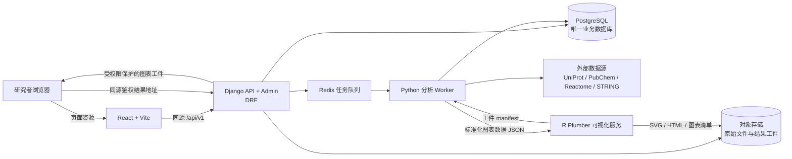

# 中医药理智能平台技术栈与阶段实施计划

版本：技术路线建议稿  
日期：2026-10-02

## 当前实施状态（2026-10-03）

当前实施分支为 `codex/django-foundation-hardening`，`origin/main` 保留作页面、字段和业务算法参考，不整体合并。`docs/main-branch-migration-inventory.md` 记录了第一版迁移映射。当前提交仅保存在本地分支，尚未推送。

阶段 0 已形成 main 分支代码、接口和旧数据依赖的初步清单；真正的 Excel/SQLite 研究数据、许可、全量字段映射和可回退导入方案尚未齐备。阶段 1 已有 Django session/CSRF 登录、用户隔离的医案与数据集 API、React/Vite 页面、Django Admin、迁移和 OpenAPI；PostgreSQL Compose 配置已加入，但当前执行环境无法连接 Docker daemon，因此还没有 PostgreSQL 实例迁移和端到端验证证据。阶段 2 已迁入 Reactome 人类通路目录和 main `backend/cache_builder.py` 生成的旧 SQLite 三表：中药—成分—靶点、疾病—靶点、疾病—中药—靶点。管理员可登记三组表/列映射；连接器将文件限制在 `SQLITE_SOURCE_ROOT` 内并只读打开，支持连接测试、后台预览、SHA-256 复核、人工应用、幂等更新和旧实体/关系软停用。54 项后端测试通过；Reactome 当前 2,883 条官方通路已在临时 SQLite 上完成预览/导入，旧缓存三表则以合成数据完成连接测试和导入验证。旧数据库和 Excel 实际文件仍不在仓库，尚未导入任何真实项目数据，也不能据合成测试确认历史字段语义。Reactome/STRING 有显式同意后的分析调用，但 UniProt、PubChem、STRING 版本目录同步 connector 仍缺。阶段 3 已有第一版蛋白组学后台链路：解析 CSV/TSV/XLS/XLSX、识别/指定列、基础阈值与逐行 QC、本地实体匹配、候选靶点交集、本地来源通路网络、Celery 任务、行级结果追溯和 CSV/XLSX/JSON 导出；按需勾选后，可把通过筛选的最多 500 个标识发送给 MyGene.info，再用 Reactome 做人类通路分析，默认不会向外部发送标识。另已迁入 main 网络药理的本地关系交集流程和 `/network-pharmacology` 页面，保存任务所有者、来源版本及靶点证据；该页面可显式提交最多 500 个标识到 Reactome 或最多 200 个标识到 STRING 获取富集/物理互作。当前仍缺 UniProt 等稳定 ID 映射、GO/KEGG、主组学流程中的 PPI 和原始矩阵统计分析、交互图表及 PDF 报告。main 的 `src/lib/proteomics.ts` 与 Reactome 服务逻辑已开始迁入，但 main 样例结果逐项对照尚未完成。阶段 4 已有医案修改审计和平台管理员审核通过，但证候/方剂模型候选、医案片段与数据库证据对齐、人工逐候选确认和下游任务链尚未实现；main 中缺乏匹配时随意回退的规则没有移植。阶段 5 尚未实现；阶段 6 目前只有本地开发 Compose，生产 Nginx/HTTPS、对象存储、备份恢复和加固未完成。React/Vite 生产构建及网络药理、外部分析合成测试通过。这些检查不代表平台已生产就绪，也不替代 PostgreSQL 验证或真实研究数据验收。

## 一、建设目标

本计划以现有中药—疾病—靶点数据库、蛋白组学分析需求和中医医案分析需求为基础，建设一个可持续更新、可追溯、可扩展的中医药理分析平台。平台按职责拆分为 Python 主站与业务服务、关系型数据库、异步分析任务、R 可视化服务四部分。用户从浏览器完成医案或组学数据提交、分析进度查看、结果交互和报告下载。

INPUT 网站作为交互参考：使用清晰的功能导航、表单输入、目录浏览和独立结果页；本项目在此基础上增加分析任务记录、数据来源追踪、用户权限、动态数据同步以及蛋白组学和医案流程。INPUT 论文介绍其页面采用 Django/HTML，分析程序使用 Python 和 R，并展示了多层网络、GO/KEGG 富集、PPI 和关键分子结果。 [论文 DOI](https://doi.org/10.1016/j.csbj.2022.03.006)

## 二、现有项目基础与差距

当前仓库已经积累了可复用的页面、API、分析逻辑和数据模型，但前后端职责分布在两套应用中：

| 当前部分 | 已有基础 | 后续处理建议 |
|---|---|---|
| Web 前端 | Next.js 15、React、TypeScript、Tailwind CSS、Recharts；已有 Dashboard、医案、网络药理、蛋白组学等页面 | Next 专用部分改为 React Router/Vite；复用现有 React 交互与 CSS 视觉，逐模块调用 Django API |
| Python 服务 | FastAPI；已有本地数据查询、靶点交集、成分比较、ChEMBL、Qwen 接入 | 盘点并抽离可复用的领域服务；目标架构将用户、管理、页面和业务 API 收敛到 Django |
| 数据层 | Prisma + SQLite；另有 Python 服务读取 Excel 和 `data_cache.db` 的逻辑；已有 Reactome 同步记录和蛋白组学模型 | 以 PostgreSQL 建立唯一业务数据源；通过可审计导入流程迁移数据，保留原始文件作为来源材料，不再把缓存文件作为线上数据库 |
| 分析能力 | TypeScript 中已有蛋白组学解析、Reactome 富集和数据库同步逻辑；Python 有数据查询与药理分析服务 | 将长期维护的分析逻辑和数据接口迁入 Python；为每个分析保留参数、输入版本、算法版本和结果 |
| R 可视化 | 仓库中暂未发现 R 分析目录或 R 包锁定文件 | 新建独立 R 服务，先约定输入/输出 JSON 与图表工件格式，再接入 Python 任务流 |

迁移过程要保护现有工作区中的数据和未提交改动。迁移前先建立数据清单、字段映射和可回退备份；只有在新旧结果核对通过后，才停止旧路径调用。

## 三、推荐技术栈

| 层级 | 推荐方案 | 职责 |
|---|---|---|
| Python 主站与 API | Django 5.2 LTS、Django REST Framework、Django Admin | 用户会话、权限、业务 API、数据库模型/迁移和管理后台；保持 Python 服务可独立运行 |
| 独立 Web 前端 | React、Vite、TypeScript；复用现有组件与 CSS | 页面导航、表单、交互图表和任务状态；通过同源 `/api/v1/` 访问 Django，保留已上传 UI |
| 数据库 | PostgreSQL | 用户、医案、方剂、中药、成分、靶点、基因、通路、数据源、分析任务、分析结果及来源证据的唯一业务存储 |
| 数据访问与迁移 | Django ORM、Django migrations | 统一模型定义、结构迁移、数据迁移和管理界面 |
| 任务队列 | Celery + Redis | 外部数据库同步、批量导入、生信分析、R 图表生成等耗时任务 |
| 文件存储 | 开发期本地受控目录；部署期 MinIO 或 S3 兼容对象存储 | 保存上传原文件、分析中间产物、SVG/HTML/PDF 等结果工件；数据库只保存对象键、元信息和校验值 |
| 生信分析 | Python：pandas、NumPy、SciPy、statsmodels、Biopython、NetworkX；按验证结果补充分析包 | 文件校验、ID 映射、差异蛋白筛选、富集和网络指标、证据整合 |
| 可视化 | R 4.x：ggplot2、plotly、visNetwork/igraph、ComplexHeatmap；Plumber 提供内部 HTTP API | 由 R 生成静态论文图和交互式图表；Python 传入整理好的图表数据，R 不直接读写业务数据库 |
| 医案智能分析 | Python 模型服务适配层 + 可替换的大模型/RAG 实现 | 医案结构化、证候候选和方剂/药物线索；所有生成内容需显示证据并允许研究者确认 |
| 部署 | Docker Compose 起步，Linux/WSL2 运行任务工作进程；Nginx 统一入口 | 将 Django、worker、Redis、PostgreSQL、R 服务和对象存储按服务隔离部署 |

本项目按“React/Vite 前端 + Django/DRF 后端”实施：这样可以保留已有 React 组件和 UI，同时由 Django 统一负责 Python 业务、会话认证、权限、数据模型和管理后台。原建议中的 Django Templates/HTMX 不作为研究者页面的迁移目标；同源反向代理提供前端页面与 `/api/v1/`，浏览器使用 Django session Cookie 和 CSRF。若保留 FastAPI，只作为迁移期兼容服务；长期不让 Django 与 FastAPI 分别维护两套用户、ORM 和核心业务模型。Django 认证功能见[官方文档](https://docs.djangoproject.com/en/5.2/topics/auth/default/)。

Redis 仅用于队列和短期缓存，不承担核心科研数据存储。Celery 的工作进程部署在 Linux/WSL2 容器中；Celery 官方文档不支持原生 Windows worker，因此 Windows 开发机通过 Docker Desktop/WSL2 运行耗时任务容器。[Celery 官方说明](https://docs.celeryq.dev/en/stable/getting-started/introduction.html)

## 四、总体架构与服务边界



服务职责边界：

1. React 管研究者页面、导航和交互；Django 管身份、权限、API、上传校验、任务登记、数据源管理、结果查询和下载授权。
2. Python worker 执行长任务，读写 PostgreSQL，通过 HTTP/API 同步外部资源，并产出统一的分析结果 JSON。
3. R 服务只接收经过校验的图表数据及绘图参数，返回工件地址、图类型、数据摘要和生成版本；不保存用户账号，不直接连接业务数据库。
4. PostgreSQL 保存结构化实体、关系、来源、任务状态和结果索引；对象存储保存大文件和图表文件。
5. 所有网页、API 与图表地址走同一域名，由 Django 做用户权限检查后代理或签发短时访问地址。

## 五、动态数据库与来源更新

数据库目标不是把多个外部网站实时拼接成一次查询，而是建立带版本和来源的本地规范化数据层，通过定时或管理员触发的同步任务更新。这样既能应对外部 API 限流/不可用，也能复现历史分析使用的数据版本。

### 数据模型重点

- 基础实体：`Herb`、`Formula`、`Compound`、`Target/Protein`、`Gene`、`Disease`、`Pathway`、`MedicalCase`。
- 关系证据：中药—成分、成分—靶点、疾病—基因、蛋白—互作、基因—通路；每条关系记录来源、外部 ID、证据类型/分值、物种、采集时间和数据版本。
- 更新记录：`DataSource`、`SyncJob`、`SyncRun`、`SourceRelease`，保存最近状态、版本、游标、读取/新增/更新/失效数量、失败原因和校验摘要。
- 分析追溯：`AnalysisTask`、`AnalysisInput`、`AnalysisResult`、`VisualizationArtifact`，关联用户、输入文件校验值、筛选阈值、分析器版本、数据库版本和图表版本。

### 更新策略

1. 为每个来源实现独立 connector：连接、健康检查、增量读取、标准化、校验、幂等 upsert、错误重试和来源版本记录。
2. 优先使用提供稳定 API 或版本下载文件的来源，例如 UniProt REST、PubChem PUG REST、Reactome Content/Analysis Service、STRING API。官方接口分别见[UniProt API](https://www.uniprot.org/api-documentation)、[PubChem PUG REST](https://pubchem.ncbi.nlm.nih.gov/docs/pug-rest)、[Reactome API](https://reactome.org/dev/content-service/)和[STRING API](https://string-db.org/help/api/)。
3. BATMAN-TCM、HERB、HIT、TCMIP、TCMSP 等来源逐个核实 API、下载许可、更新频率及引用要求；没有稳定公开接口或授权自动抓取的来源，采用有版本号的授权文件导入和人工审核，不承诺自动同步。
4. 同步先落临时区，做字段/记录数/ID 校验，再在事务中发布；删除或缺失记录先标记为失效并保留历史，不在同步时物理清除证据。
5. 每次分析固定使用的数据版本；更新后可重复旧分析，或显式创建新版本重跑。
6. 提供管理员控制台，展示同步状态、上次成功时间、数据差异、失败日志和“试运行/正式应用”按钮。

PostgreSQL 主存实体关系，JSONB 仅保存不规则原始响应或分析参数，不把整套关系图塞进一个 JSON 字段。[PostgreSQL JSON/JSONB 文档](https://www.postgresql.org/docs/current/datatype-json.html)。第一阶段不同时引入 Neo4j 与 Milvus：先以关系表构建网络数据、以 PostgreSQL 保存检索和证据；当图查询性能或语义检索需求通过实际压测确认后，再评估图数据库或 pgvector。

## 六、生物信息学分析全链路

首期聚焦“批量差异蛋白 → 标准化靶标 → 富集与互作 → 关键分子 → 可视化报告”，同时为原始定量矩阵留出扩展入口。

1. **上传和解析**：支持 CSV、TSV、XLSX 和基因/蛋白列表；用户映射列名、物种、对照组/实验组。记录文件名、大小、校验值和列映射，不将原文件内容直接写入代码或前端。
2. **质量检查**：检查缺失值、重复 ID、数值格式、非法 p 值、样本列和分组完整性；给出排除数量、排除原因和可下载的校验报告。
3. **蛋白/基因标准化**：优先匹配 UniProt accession、Gene Symbol、Entrez ID；保留原始标签和标准化映射、映射来源及不确定项，未映射条目单独呈现，不静默丢弃。
4. **差异分析**：首期兼容已含 `log2FC`、`p-value`、`FDR` 的差异蛋白表；对原始定量矩阵，必须由用户提供实验设计和分组信息，完成缺失/归一化策略后再纳入统计分析，不能仅凭列名自动假定实验设计。
5. **功能富集**：GO、KEGG/Reactome；输出输入数、映射数、背景集、命中基因、GeneRatio、p 值和多重检验校正值，并保留所用物种和数据库版本。
6. **互作和网络指标**：按用户设置的 STRING 置信度获取 PPI；计算 degree、betweenness 等候选中心性指标。中心性排名属于网络证据，不单独作为生物学因果结论。
7. **交叉验证**：将差异蛋白与中药成分预测靶点、疾病相关基因、药理实验候选靶点求交集；逐条展示来源、证据类别、分值和方向，支持研究者筛选。
8. **结果交付**：任务状态经历 `QUEUED → RUNNING → SUCCEEDED/FAILED`；结果可检索、复核、重跑、导出 CSV/XLSX/PDF，并记录全部参数和来源版本。

每个步骤拆成可独立重跑的 Python service/worker task，任务失败保留错误阶段和日志；前端轮询状态或使用 SSE 推送进度，避免长时间请求占用 Web worker。

## 七、医案分析全链路

平台定位为科研辅助和假设生成，不输出未经复核的临床诊断。推荐流程为：

`脱敏医案 → 症状/舌脉/病程结构化 → 证候候选 → 方剂候选 → 方剂拆解为中药 → 成分 → 靶点/蛋白 → 疾病相关基因 → 通路与 PPI → 与实验组学结果交叉验证`

- 录入时提示移除姓名、电话、身份证号、详细地址等直接身份信息；为案例设置访问权限、审计日志和数据保留规则。
- LLM 返回结构化 JSON、原文证据片段、候选置信度和模型版本；证候/方剂候选需由研究者确认后进入下游药理分析。
- RAG 检索只使用明确登记来源的医案、方剂和本草知识，展示文献/知识条目及出处；不同来源冲突时并列给出，不自动合并成确定事实。
- 方剂、药物、成分和靶点分析均沿用同一套规范化实体 ID 和证据表，避免医案模块形成第二套知识库。
- 首批以麦门冬汤相关肺纤维化项目作为验证案例，围绕“肠道菌群—胆汁酸—巨噬细胞极化”轴，将医案/方药证据与实验差异蛋白和通路结果并列展示。

## 八、R 可视化模块

Python 统一生成 chart-ready JSON，包含图类型、单位、标签、物种、阈值、数据库版本和结果 ID；R Plumber 接收该 JSON 并返回工件 manifest。R 不自行重新筛选输入实体，以保证图与表使用同一份分析结果。

首批图形：

- 差异蛋白：火山图、样本 PCA/相关性、差异蛋白热图。
- 富集：GO/KEGG/Reactome 气泡图、条形图和基因—通路对应表。
- 网络：分类型 PPI/药理网络，可搜索、缩放、拖动节点，按 degree/效应量着色或排序。
- 机制链路：中药—成分—靶点—通路—疾病 Sankey/关联图。
- 结果输出：交互式 HTML 用于网页浏览；SVG/PDF 用于论文与汇报；PNG 作为通用预览。

每个图都附带数据表、图例、阈值说明和版本信息。R 服务只开放内网端口，校验任务 ID 和调用令牌，并对图表文件设置大小限制与超时。Plumber 的作用是将 R 函数包装为 HTTP API，见[官方快速入门](https://www.rplumber.io/articles/quickstart.html)。

## 九、建议的代码目录

```text
tcm_pharmacology_platform/
├─ python_app/
│  ├─ manage.py
│  ├─ config/                 # Django 配置、路由、权限、任务队列
│  ├─ apps/
│  │  ├─ accounts/            # 用户、角色和审计
│  │  ├─ knowledge/           # 中药、方剂、成分、靶点、疾病、通路
│  │  ├─ sources/             # 数据源 connector 和同步任务
│  │  ├─ proteomics/          # 数据集、质控、差异蛋白、富集、PPI
│  │  ├─ cases/               # 医案、证候、方剂推理和人工确认
│  │  ├─ analyses/            # 任务状态、结果追溯、导出
│  │  └─ visualization/       # R 服务调用与图表工件权限
│  └─ static/                 # Django Admin 等后端静态资源
├─ web/                       # React/Vite/TypeScript 研究者页面与复用 UI
├─ r_viz/
│  ├─ plumber.R
│  ├─ R/                      # ggplot2、plotly、网络图函数
│  └─ renv.lock               # R 依赖锁定
├─ deploy/                    # Docker Compose、Nginx、环境变量样例
└─ docs/                      # API 合约、数据字典和实施记录
```

目录作为目标结构建议，迁移时按现有文件逐步归位，不一次性搬动所有源代码和用户数据。

## 十、阶段计划与验收条件

| 阶段 | 目标 | 主要交付 | 验收条件 |
|---|---|---|---|
| 0. 现状盘点与契约冻结 | 建立数据/页面/API/模型清单 | 数据字典、旧新字段映射、API v1 草案、可回退迁移清单 | 明确每项数据的当前来源、持有人、格式、许可和迁移方式 |
| 1. Python 主站与数据库 | 建立 Django API/Admin、React 页面、登录权限和 PostgreSQL 模型 | 独立可运行的 Django API 与 React/Vite 前端、迁移脚本、管理员/研究者权限 | 可登录、保护私有页面、CRUD 医案/数据集/任务；数据在 PostgreSQL 可读写 |
| 2. 动态数据同步 | 建立 connector、同步任务和来源控制台 | 首批 UniProt/PubChem/Reactome/STRING 接入；其他来源的导入适配器 | 可试运行并显示差异；重复同步幂等；保存来源版本和失败日志 |
| 3. 蛋白组学链路 | 完成上传、QC、映射、富集、PPI 和结果持久化 | 完整的差异蛋白结果页和可追溯分析记录 | 同一输入和参数可复跑；映射、排除、命中数可核对；结果可导出 |
| 4. 医案分析链路 | 完成医案结构化、候选生成、确认和药理关联 | 医案工作台、证据展示、人工审核和链路分析任务 | 每条候选可追溯到医案片段/数据库来源；人工修改留有审计记录 |
| 5. R 图表服务 | 统一图表 JSON 合约并部署 Plumber | 图表 API、版本锁定、静态和交互图表工件 | Python 与 R 同一任务结果一一对应；网页可授权查看；可下载 SVG/PDF/HTML |
| 6. 一体化与部署 | 完成旧页面迁移、Docker 化和运行手册 | Django + worker + Redis + PostgreSQL + R + 对象存储部署配置 | 新用户可按文档启动；旧服务逐模块下线；数据库备份与恢复步骤可执行 |

截至 2026-10-03 的完成度：阶段 0、1 为部分完成；阶段 2 已有 Reactome/SQLite 三表预览和人工应用闭环，但未用真实旧数据库验收，UniProt/PubChem/STRING 目录同步仍缺；阶段 3 为本地蛋白组学加可选 Reactome 和网络药理页可选 STRING 的第一版，尚无 main 黄金样例验收；阶段 4 已有医案修改审计与管理员审核，模型候选与证据确认链尚缺；阶段 5 尚未开始；阶段 6 只有本地开发 Compose。各阶段的详细缺口和可复核证据记录在 [`docs/main-branch-migration-inventory.md`](main-branch-migration-inventory.md) 与 [`docs/architecture-current.md`](architecture-current.md)。

每阶段先用代表性数据集做小规模验收，再增加并发和数据量。月份和人员投入待确定开发成员、可用实验数据和部署环境后补入，不在当前计划中虚构工期承诺。

## 十一、当前需要先落地的 Python 范围

第一轮开发先完成以下闭环，为 R 接入提供稳定数据契约：

1. 建立 Django + PostgreSQL API 基础，完成 React 页面导航、登录权限、数据集/医案/分析任务模型和 Django 管理后台。
2. 建立 `/api/v1/`：健康状态、数据源、上传、分析任务创建/状态/结果查询、结果下载接口。
3. 把 FastAPI 中可复用的本地查询、成分比较、靶点交集和外部接口访问拆成领域服务；移除业务逻辑对固定 Excel 路径和 `data_cache.db` 的隐式依赖，改由来源 connector 或显式数据导入提供数据。
4. 把目前 Next.js 中的蛋白组学文件解析、Reactome 通路分析和同步任务按 API 合约迁入 Python，逐项核对结果后再切换页面调用。
5. 定义稳定的图表输入 JSON、任务结果 JSON 和图表 manifest；此阶段先产出可复用数据，不把 R 包装成一次性脚本。
6. 隔离依赖：Web 核心、分析 worker、模型服务、桌面 PyQt 程序分别维护依赖清单；将 `PyQt5/PyQtWebEngine` 从网站运行时依赖中移出。

## 十二、实施约束和风险控制

- 对外数据库接口会限流、变更或短暂不可用；同步必须支持重试、游标、版本记录和本地可复现，不让用户查询依赖实时 API 成功。
- 预测靶点、数据库关联、网络中心性和模型生成内容属于不同证据类型；界面要分层标记，不能统一显示成已验证结论。
- 医案可能包含敏感健康信息；默认脱敏、按用户授权隔离、限制原文导出，并记录查看和修改审计。
- 数据导入要保存原始文件校验值、字段映射、映射失败清单及处理参数，避免仅保留清洗后的表。
- R 只接收必要的绘图数据，不接收患者身份字段或账户信息；R 服务失败时，分析表格和 CSV 结果仍可访问。
- 生产密钥、数据库连接串和外部 API 凭证只放环境变量/密钥管理服务，不提交到 GitHub；生产 CORS 仅允许部署域名。
- 先用 PostgreSQL 关系模型满足当前实体与证据查询。是否增加 Neo4j、独立向量库或图计算集群，依据真实查询耗时、规模和运维能力评估。

## 参考资料

- Li X, Tang Q, Meng F, et al. INPUT: An intelligent network pharmacology platform unique for traditional Chinese medicine. *Computational and Structural Biotechnology Journal*. 2022;20:1345–1351. [DOI](https://doi.org/10.1016/j.csbj.2022.03.006)
- [Django authentication](https://docs.djangoproject.com/en/5.2/topics/auth/default/)
- [Celery task queue](https://docs.celeryq.dev/en/stable/getting-started/introduction.html)
- [PostgreSQL JSON types](https://www.postgresql.org/docs/current/datatype-json.html)
- [UniProt API](https://www.uniprot.org/api-documentation)
- [MyGene.info query service](https://docs.mygene.info/en/latest/doc/query_service.html)
- [PubChem PUG REST](https://pubchem.ncbi.nlm.nih.gov/docs/pug-rest)
- [Reactome Content Service](https://reactome.org/dev/content-service/)
- [STRING API](https://string-db.org/help/api/)
- [R Plumber quickstart](https://www.rplumber.io/articles/quickstart.html)
