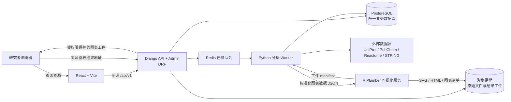

# 中医药理智能平台技术栈与阶段实施计划

版本：技术路线建议稿  
日期：2026-10-02

## 当前实施状态（2026-10-03）

当前实施分支为 `codex/django-foundation-hardening`，`origin/main` 保留作页面、字段和业务算法参考，不整体合并。`docs/main-branch-migration-inventory.md` 记录了第一版迁移映射。当前提交仅保存在本地分支，尚未推送。

当前迁移顺序已明确：先迁 `main` 中有源码且可核验的现有页面和业务，不新造业务模块，也不先写替代模块后再换掉。为接入 Django + React/Vite 必需的路由、权限、统一错误、数据适配和测试属于迁移工作；缺旧数据文件/服务支撑的功能先保留待迁位置，计划中 `main` 没有的扩展能力留到现有功能核对之后。

阶段 0 已盘点 `origin/main` 的主要页面、接口、模型和旧数据依赖，但缺少原 SQLite/Excel 文件、许可证明及真实样例，因此字段语义确认和可回退历史数据迁移仍未完成。阶段 1 已有 Django session/CSRF、研究者数据隔离、React/Vite 页面、Django Admin、API 文档和迁移；研究者注册现要求 24 小时一次性邮箱验证后再由管理员启用，管理员仅在邮箱验证成功后收到可选通知；真实 SMTP 收件、PostgreSQL 实例和容器仍待部署环境验证。
main 的登录后 `/dashboard` 总览页已迁入 React Router，Django 汇总数据集、医案、任务和知识目录数量及最近五项任务；研究者统计只按当前账号过滤，超级管理员可看全平台。登录成功后默认进入总览。
阶段 2 已实现 Reactome、旧 SQLite 三表、UniProt、PubChem 和 STRING 标识映射的版本化预览/人工应用路径；UniProt/Reactome/PubChem 的记录数与临时库验证、STRING 单条官方调用结果已分别记入迁移清单。旧 SQLite 实际文件和项目成分映射尚未核实，也没有把试验数据写进正式库。
阶段 3 已支持差异蛋白文件解析、QC、映射、任务追溯/导出、本地网络药理交集、用户单独同意后的 Reactome/STRING/g:Profiler 分析及 R 静态图表请求；网络药理页已借鉴 main 的分层关系图加入 React/SVG 交互图，支持类型筛选、缩放和查看来源记录，并对图形显示数量设上限。原始定量矩阵已支持研究者显式指定的非配对 Welch 检验、按配对编号指定样本关系的配对 t 检验，以及明确声明多分类因素和主要对比的加性线性模型 t 对比；三者均使用 BH-FDR，不作缺失值插补。多因素模型只拟合主效应，不拟合交互项/随机效应，且假设样本独立、方差齐性和残差近似正态；完全混杂会拒绝设计，逐行缺失导致的降秩会排除该行；真实实验样例、非人类/全量 ID 覆盖和 R 火山图任务与渲染代码已接入但容器未实跑，PCA/相关性、热图和交互网络图仍未完成；PDF 汇总报告首版已接入（最多展示 500 条重点结果，全量逐行数据在 CSV/XLSX），真实样例与版式验收待完成；g:Profiler 真实项目结果、main 黄金样例逐项比对及 R 容器实跑仍待验收。
阶段 4 已迁移 main 的四组文本证候关键词规则、稳定排序、任务历史、可选医案绑定、来源快照和 CSV/PDF 导出；无命中不回退，规则候选不会自动确诊。医案结构化、科研助手和本地知识检索已有首版：研究者主动同意后，系统只向已配置的本机/内网模型发送脱敏正文、舌脉、已有诊断及启用来源版本下匹配到的知识实体/一跳关系；候选引文须与医案原文逐字匹配，模型引用的知识记录须命中本次检索白名单；不同来源版本并列保留，不自动合并；证候/方剂需按本地规范名或同义词唯一匹配，并由研究者逐条确认/驳回及审计。科研助手由研究者选择最多 8 个启用来源实体，先冻结证据和来源版本，再创建用户归属的 Celery 任务；默认只返回本地证据，只有每次明确同意后才向本机/内网模型提交问题和所选证据，模型引用只接受本次证据白名单。检索有条数和总输入字符上限，来源版本与任务绑定；已确认的方剂可预填到网络药理工作台，服务端复核确认状态与医案内容哈希后，按带来源版本的方剂—中药关系展开，并把任务关联回医案/候选。仍缺真实模型和项目医案验收、更广文献语料/语义召回、组学交叉验证及更完整的任务编排，因此阶段 4 仍是部分完成。
阶段 5 已有受控 R Plumber 静态柱图/气泡图/火山图代码、私有工件和授权下载路径，未在 Docker/R 运行环境实际构建。阶段 6 已有 PostgreSQL/Redis/worker/R/Nginx/S3 的生产 Compose 与备份恢复脚本，但 TLS、对象存储、数据库和恢复演练均尚未实机验证。
截至本次变更：main 文本证候工作台 `/analysis` 已迁移，医案/数据集列表支持 `q` 字段搜索，管理员可安全删除无版本/历史的数据源登记；共享工作台导航已统一，网络药理已有统计图和候选靶点/来源证据下载。main 原有管理员 API 接入监测页已迁入 `/admin/integrations`；状态检查适配为当前 Django/数据库、来源目录与模型配置，疾病/中药/成分/交集/成分比对测试调用当前 Django 业务服务，靶点交集不写入正式任务。ChEMBL 与本机模型的网络测试需每次单独同意；main 的 AI Scientist 旧路径依赖未随仓库提供的 Excel/SQLite 数据，页面注明待迁移。研究者注册已接通 24 小时邮箱验证、CSRF 保护、限流、无账号枚举的验证链接重发、验证后可选管理员通知，以及后台修改邮箱时撤销验证并停用账号；开发邮件打印到控制台，生产须配置 SMTP。新迁移为既有研究者补建验证资料，迁移前已启用的账号标记为历史已验证，未启用账号仍需走验证/审核流程。上述功能有自动化 API、到期/重放、通知、邮件投递失败回滚和管理员改邮箱测试；真实 SMTP 尚未验收。该项是新系统账号安全流程，不从 `origin/main` 复制其旧 Cookie 鉴权实现。科研知识检索页已迁移本地实体搜索、双向来源证据展示、JSON 导出、ChEMBL 官方分子/活性查询、main 的中英文/拉丁别名展开、用户提供的检测列表—参考列表名称对照，以及 51 组 main 中文疾病精确别名对本地启用疾病目录的检索；别名只扩展查询，不作为疾病证据，页面展示实际命中的目录名称和来源版本。main 的批量中药/成分关系查询现可在本地版本化目录执行，每批最多 12 项，结果保留关系来源版本及记录号。科研助手已迁移为异步证据约束任务：研究者选定本地实体，任务冻结证据版本；默认只检索，逐次同意后才向配置的本机/内网模型提交问题和所选证据，模型引用受限于本次白名单。Django SQLite 全量 223 项自动化测试、迁移检查、系统检查、无警告 OpenAPI 校验和 TypeScript/Vite 生产构建均已通过；当前执行环境 Docker socket 权限不足，容器尚未实机验证。这些检查不等同于 PostgreSQL、模型、R 容器、真实旧数据或生产环境验收。

## 一、建设目标

本计划以现有中药—疾病—靶点数据库、蛋白组学分析需求和中医医案分析需求为基础，建设一个可持续更新、可追溯、可扩展的中医药理分析平台。平台按职责拆分为 Python 主站与业务服务、关系型数据库、异步分析任务、R 可视化服务四部分。用户从浏览器完成医案或组学数据提交、分析进度查看、结果交互和报告下载。

INPUT 网站作为交互参考：使用清晰的功能导航、表单输入、目录浏览和独立结果页；本项目在此基础上增加分析任务记录、数据来源追踪、用户权限、动态数据同步以及蛋白组学和医案流程。INPUT 论文介绍其页面采用 Django/HTML，分析程序使用 Python 和 R，并展示了多层网络、GO/KEGG 富集、PPI 和关键分子结果。 [论文 DOI](https://doi.org/10.1016/j.csbj.2022.03.006)

## 二、现有项目基础与差距

当前仓库已经积累了可复用的页面、API、分析逻辑和数据模型，但前后端职责分布在两套应用中：

| 当前部分 | 已有基础 | 后续处理建议 |
|---|---|---|
| Web 前端 | Next.js 15、React、TypeScript、Tailwind CSS、Recharts；已有 Dashboard、医案、网络药理、蛋白组学等页面 | Next 专用部分改为 React Router/Vite；复用现有 React 交互与 CSS 视觉，逐模块调用 Django API |
| Python 服务 | FastAPI；已有本地数据查询、靶点交集、成分比较、ChEMBL、Qwen 接入 | 盘点并抽离可复用的领域服务；目标架构将用户、管理、页面和业务 API 收敛到 Django |
| 数据层 | Prisma + SQLite；另有 Python 服务读取 Excel 和 `data_cache.db` 的逻辑；已有 Reactome 同步记录和蛋白组学模型 | 以 PostgreSQL 建立唯一业务数据源；通过可审计导入流程迁移数据，保留原始文件作为来源材料，不再把缓存文件作为线上数据库 |
| 分析能力 | TypeScript 中已有蛋白组学解析、Reactome 富集和数据库同步逻辑；Python 有数据查询与药理分析服务 | 将长期维护的分析逻辑和数据接口迁入 Python；为每个分析保留参数、输入版本、算法版本和结果 |
| R 可视化 | 仓库中暂未发现 R 分析目录或 R 包锁定文件 | 新建独立 R 服务，先约定输入/输出 JSON 与图表工件格式，再接入 Python 任务流 |

迁移过程要保护现有工作区中的数据和未提交改动。迁移前先建立数据清单、字段映射和可回退备份；只有在新旧结果核对通过后，才停止旧路径调用。

## 三、推荐技术栈

| 层级 | 推荐方案 | 职责 |
|---|---|---|
| Python 主站与 API | Django 5.2 LTS、Django REST Framework、Django Admin | 用户会话、权限、业务 API、数据库模型/迁移和管理后台；保持 Python 服务可独立运行 |
| 独立 Web 前端 | React、Vite、TypeScript；复用现有组件与 CSS | 页面导航、表单、交互图表和任务状态；通过同源 `/api/v1/` 访问 Django，保留已上传 UI |
| 数据库 | PostgreSQL | 用户、医案、方剂、中药、成分、靶点、基因、通路、数据源、分析任务、分析结果及来源证据的唯一业务存储 |
| 数据访问与迁移 | Django ORM、Django migrations | 统一模型定义、结构迁移、数据迁移和管理界面 |
| 任务队列 | Celery + Redis | 外部数据库同步、批量导入、生信分析、R 图表生成等耗时任务 |
| 文件存储 | 开发期本地受控目录；部署期私有 S3 兼容对象存储 | 保存上传原文件、分析中间产物、SVG/HTML/PDF 等结果工件；数据库只保存对象键、元信息和校验值 |
| 生信分析 | Python：pandas、NumPy、SciPy、statsmodels、Biopython、NetworkX；按验证结果补充分析包 | 文件校验、ID 映射、差异蛋白筛选、富集和网络指标、证据整合 |
| 可视化 | R 4.x：ggplot2、plotly、visNetwork/igraph、ComplexHeatmap；Plumber 提供内部 HTTP API | 由 R 生成静态论文图和交互式图表；Python 传入整理好的图表数据，R 不直接读写业务数据库 |
| 医案智能分析 | Python 模型服务适配层 + 可替换的大模型/RAG 实现 | 医案结构化、证候候选和方剂/药物线索；所有生成内容需显示证据并允许研究者确认 |
| 部署 | Docker Compose 起步，Linux/WSL2 运行任务工作进程；Nginx 统一入口 | 将 Django、worker、Redis、PostgreSQL、R 服务隔离部署，对象文件进入私有 S3 兼容存储 |

本项目按“React/Vite 前端 + Django/DRF 后端”实施：这样可以保留已有 React 组件和 UI，同时由 Django 统一负责 Python 业务、会话认证、权限、数据模型和管理后台。原建议中的 Django Templates/HTMX 不作为研究者页面的迁移目标；同源反向代理提供前端页面与 `/api/v1/`，浏览器使用 Django session Cookie 和 CSRF。若保留 FastAPI，只作为迁移期兼容服务；长期不让 Django 与 FastAPI 分别维护两套用户、ORM 和核心业务模型。Django 认证功能见[官方文档](https://docs.djangoproject.com/en/5.2/topics/auth/default/)。

Redis 仅用于队列和短期缓存，不承担核心科研数据存储。Celery 的工作进程部署在 Linux/WSL2 容器中；Celery 官方文档不支持原生 Windows worker，因此 Windows 开发机通过 Docker Desktop/WSL2 运行耗时任务容器。[Celery 官方说明](https://docs.celeryq.dev/en/stable/getting-started/introduction.html)

## 四、总体架构与服务边界



服务职责边界：

1. React 管研究者页面、导航和交互；Django 管身份、权限、API、上传校验、任务登记、数据源管理、结果查询和下载授权。
2. Python worker 执行长任务，读写 PostgreSQL，通过 HTTP/API 同步外部资源，并产出统一的分析结果 JSON。
3. R 服务只接收经过校验的图表数据及绘图参数，返回工件地址、图类型、数据摘要和生成版本；不保存用户账号，不直接连接业务数据库。
4. PostgreSQL 保存结构化实体、关系、来源、任务状态和结果索引；对象存储保存大文件和图表文件。
5. 所有网页、API 与图表地址走同一域名，由 Django 做用户权限检查后代理或签发短时访问地址。

## 五、动态数据库与来源更新

数据库目标不是把多个外部网站实时拼接成一次查询，而是建立带版本和来源的本地规范化数据层，通过定时或管理员触发的同步任务更新。这样既能应对外部 API 限流/不可用，也能复现历史分析使用的数据版本。

### 数据模型重点

- 基础实体：`Herb`、`Formula`、`Compound`、`Target/Protein`、`Gene`、`Disease`、`Pathway`、`MedicalCase`。
- 关系证据：中药—成分、成分—靶点、疾病—基因、蛋白—互作、基因—通路；每条关系记录来源、外部 ID、证据类型/分值、物种、采集时间和数据版本。
- 更新记录：`DataSource`、`SyncJob`、`SyncRun`、`SourceRelease`，保存最近状态、版本、游标、读取/新增/更新/失效数量、失败原因和校验摘要。
- 分析追溯：`AnalysisTask`、`AnalysisInput`、`AnalysisResult`、`VisualizationArtifact`，关联用户、输入文件校验值、筛选阈值、分析器版本、数据库版本和图表版本。

### 更新策略

1. 为每个来源实现独立 connector：连接、健康检查、增量读取、标准化、校验、幂等 upsert、错误重试和来源版本记录。
2. 优先使用提供稳定 API 或版本下载文件的来源，例如 UniProt REST、PubChem PUG REST、Reactome Content/Analysis Service、STRING API。官方接口分别见[UniProt API](https://www.uniprot.org/api-documentation)、[PubChem PUG REST](https://pubchem.ncbi.nlm.nih.gov/docs/pug-rest)、[Reactome API](https://reactome.org/dev/content-service/)和[STRING API](https://string-db.org/help/api/)。
3. BATMAN-TCM、HERB、HIT、TCMIP、TCMSP 等来源逐个核实 API、下载许可、更新频率及引用要求；没有稳定公开接口或授权自动抓取的来源，采用有版本号的授权文件导入和人工审核，不承诺自动同步。
4. 同步先落临时区，做字段/记录数/ID 校验，再在事务中发布；删除或缺失记录先标记为失效并保留历史，不在同步时物理清除证据。
5. 每次分析固定使用的数据版本；更新后可重复旧分析，或显式创建新版本重跑。
6. 提供管理员控制台，展示同步状态、上次成功时间、数据差异、失败日志和“试运行/正式应用”按钮。

PostgreSQL 主存实体关系，JSONB 仅保存不规则原始响应或分析参数，不把整套关系图塞进一个 JSON 字段。[PostgreSQL JSON/JSONB 文档](https://www.postgresql.org/docs/current/datatype-json.html)。第一阶段不同时引入 Neo4j 与 Milvus：先以关系表构建网络数据、以 PostgreSQL 保存检索和证据；当图查询性能或语义检索需求通过实际压测确认后，再评估图数据库或 pgvector。

## 六、生物信息学分析全链路

首期聚焦“批量差异蛋白 → 标准化靶标 → 富集与互作 → 关键分子 → 可视化报告”，并支持明确指定非配对或配对设计的原始定量矩阵统计。

1. **上传和解析**：支持 CSV、TSV、XLSX 和基因/蛋白列表；用户映射列名、物种、对照组/实验组。记录文件名、大小、校验值和列映射，不将原文件内容直接写入代码或前端。
2. **质量检查**：检查缺失值、重复 ID、数值格式、非法 p 值、样本列和分组完整性；给出排除数量、排除原因和可下载的校验报告。
3. **蛋白/基因标准化**：优先匹配 UniProt accession、Gene Symbol、Entrez ID；保留原始标签和标准化映射、映射来源及不确定项，未映射条目单独呈现，不静默丢弃。
4. **差异分析**：兼容已含 `log2FC`、`p-value`、`FDR` 的差异蛋白表；原始定量矩阵要求用户明确选择非配对、配对或分类因素多因素设计，提供样本/因素映射和主要对比，并明确输入尺度、归一化和缺失策略；多因素首版拟合加性主效应模型，不自动添加交互项，也不会仅凭列名假定实验设计。
5. **功能富集**：GO、KEGG/Reactome；输出输入数、映射数、背景集、命中基因、GeneRatio、p 值和多重检验校正值，并保留所用物种和数据库版本。
6. **互作和网络指标**：按用户设置的 STRING 置信度获取 PPI；计算 degree、betweenness 等候选中心性指标。中心性排名属于网络证据，不单独作为生物学因果结论。
7. **交叉验证**：将差异蛋白与中药成分预测靶点、疾病相关基因、药理实验候选靶点求交集；逐条展示来源、证据类别、分值和方向，支持研究者筛选。
8. **结果交付**：任务状态经历 `QUEUED → RUNNING → SUCCEEDED/FAILED`；结果可检索、复核、重跑、导出 CSV/XLSX/PDF，并记录全部参数和来源版本。

每个步骤拆成可独立重跑的 Python service/worker task，任务失败保留错误阶段和日志；前端轮询状态或使用 SSE 推送进度，避免长时间请求占用 Web worker。

## 七、医案分析全链路

平台定位为科研辅助和假设生成，不输出未经复核的临床诊断。推荐流程为：

`脱敏医案 → 症状/舌脉/病程结构化 → 证候候选 → 方剂候选 → 方剂拆解为中药 → 成分 → 靶点/蛋白 → 疾病相关基因 → 通路与 PPI → 与实验组学结果交叉验证`

- 录入时提示移除姓名、电话、身份证号、详细地址等直接身份信息；为案例设置访问权限、审计日志和数据保留规则。
- LLM 返回结构化 JSON、原文证据片段、候选置信度和模型版本；证候/方剂候选需由研究者确认后进入下游药理分析；当前已实现确认方剂到本地网络药理工作台的有来源版本流程。
- RAG 检索只使用明确登记来源的医案、方剂和本草知识，展示文献/知识条目及出处；不同来源冲突时并列给出，不自动合并成确定事实。
- 方剂、药物、成分和靶点分析均沿用同一套规范化实体 ID 和证据表，避免医案模块形成第二套知识库。
- 首批以麦门冬汤相关肺纤维化项目作为验证案例，围绕“肠道菌群—胆汁酸—巨噬细胞极化”轴，将医案/方药证据与实验差异蛋白和通路结果并列展示。

当前已完成安全边界明确的第一步：分析请求必须由研究者单独同意；只把脱敏正文、舌脉和已有诊断，以及由医案规范实体提及召回的启用来源版本知识记录发送到受信任本机/内网模型，要求部署者记录实际模型版本；返回观察和候选必须附可逐字核验的原文引文，知识库引用还必须对应本次检索白名单；证候/方剂仅按本地规范名或同义词唯一匹配，研究者逐条确认后才遍历有版本来源的本地实体关系。RAG 当前为受限精确提及 + 一跳关系首版；确认的方剂可进入网络药理工作台，继续沿方剂—中药—成分—靶点证据分析并把结果任务关联回医案。更广全文文献、语义召回、组学交叉验证尚未接入，也未由真实模型和项目医案验收。

## 八、R 可视化模块

Python 统一生成 chart-ready JSON，包含图类型、单位、标签、物种、阈值、数据库版本和结果 ID；R Plumber 接收该 JSON 并返回工件 manifest。R 不自行重新筛选输入实体，以保证图与表使用同一份分析结果。

首批图形：

- 差异蛋白：火山图、样本 PCA/相关性、差异蛋白热图。
- 富集：GO/KEGG/Reactome 气泡图、条形图和基因—通路对应表。
- 网络：分类型 PPI/药理网络，可搜索、缩放、拖动节点，按 degree/效应量着色或排序。
- 机制链路：中药—成分—靶点—通路—疾病 Sankey/关联图。
- 结果输出：交互式 HTML 用于网页浏览；SVG/PDF 用于论文与汇报；PNG 作为通用预览。

每个图都附带数据表、图例、阈值说明和版本信息。R 服务只开放内网端口，校验任务 ID 和调用令牌，并对图表文件设置大小限制与超时。Plumber 的作用是将 R 函数包装为 HTTP API，见[官方快速入门](https://www.rplumber.io/articles/quickstart.html)。

## 九、建议的代码目录

```text
tcm_pharmacology_platform/
├─ python_app/
│  ├─ manage.py
│  ├─ config/                 # Django 配置、路由、权限、任务队列
│  ├─ apps/
│  │  ├─ accounts/            # 用户、角色和审计
│  │  ├─ knowledge/           # 中药、方剂、成分、靶点、疾病、通路
│  │  ├─ sources/             # 数据源 connector 和同步任务
│  │  ├─ proteomics/          # 数据集、质控、差异蛋白、富集、PPI
│  │  ├─ cases/               # 医案、证候、方剂推理和人工确认
│  │  ├─ analyses/            # 任务状态、结果追溯、导出
│  │  └─ visualization/       # R 服务调用与图表工件权限
│  └─ static/                 # Django Admin 等后端静态资源
├─ web/                       # React/Vite/TypeScript 研究者页面与复用 UI
├─ r_viz/
│  ├─ plumber.R
│  ├─ R/                      # ggplot2、plotly、网络图函数
│  └─ renv.lock               # R 依赖锁定
├─ deploy/                    # Docker Compose、Nginx、环境变量样例
└─ docs/                      # API 合约、数据字典和实施记录
```

目录作为目标结构建议，迁移时按现有文件逐步归位，不一次性搬动所有源代码和用户数据。

## 十、阶段计划与验收条件

| 阶段 | 目标 | 主要交付 | 验收条件 |
|---|---|---|---|
| 0. 现状盘点与契约冻结 | 建立数据/页面/API/模型清单 | 数据字典、旧新字段映射、API v1 草案、可回退迁移清单 | 明确每项数据的当前来源、持有人、格式、许可和迁移方式 |
| 1. Python 主站与数据库 | 建立 Django API/Admin、React 页面、登录权限和 PostgreSQL 模型 | 独立可运行的 Django API 与 React/Vite 前端、迁移脚本、管理员/研究者权限 | 可登录、保护私有页面、CRUD 医案/数据集/任务；数据在 PostgreSQL 可读写 |
| 2. 动态数据同步 | 建立 connector、同步任务和来源控制台 | 首批 UniProt/PubChem/Reactome/STRING 接入；其他来源的导入适配器 | 可试运行并显示差异；重复同步幂等；保存来源版本和失败日志 |
| 3. 蛋白组学链路 | 完成上传、QC、映射、富集、PPI 和结果持久化 | 完整的差异蛋白结果页和可追溯分析记录 | 同一输入和参数可复跑；映射、排除、命中数可核对；结果可导出 |
| 4. 医案分析链路 | 完成医案结构化、候选生成、确认和药理关联 | 医案工作台、证据展示、人工审核和链路分析任务 | 每条候选可追溯到医案片段/数据库来源；人工修改留有审计记录 |
| 5. R 图表服务 | 统一图表 JSON 合约并部署 Plumber | 图表 API、版本锁定、静态和交互图表工件 | Python 与 R 同一任务结果一一对应；网页可授权查看；可下载 SVG/PDF/HTML |
| 6. 一体化与部署 | 完成旧页面迁移、Docker 化和运行手册 | Django + worker + Redis + PostgreSQL + R + Nginx/HTTPS + 私有对象存储部署配置 | 新用户可按文档启动；旧服务逐模块下线；数据库备份与恢复步骤可执行并在部署环境演练 |

截至 2026-10-03：阶段 0、1 部分完成，含受管理员审核的研究者注册申请；缺旧研究数据、许可和 PostgreSQL 实机验收，邮箱验证与可选管理员通知已实现，真实 SMTP 收件仍待验收；阶段 2 的首批来源 connector、版本预览/人工应用已有代码和临时数据验证，真实旧库、真实项目映射及生产数据库应用仍待确认；阶段 3 有差异蛋白首版、网络药理、GO/KEGG、Reactome、STRING 和静态 R 图表代码，原始定量矩阵已接入非配对 Welch 检验与显式编号配对 t 检验首版（需用户指定分组/配对关系、数值尺度、归一化和缺失策略，不做插补）；多因素分类设计加性模型首版已接入（不含交互项），真实实验样例验收、非人类/全量稳定标识覆盖和 R 交互图仍待完成；g:Profiler 官方 POST 已用合成标识完成一次连通性 smoke test（无显著结果），科研检索已迁移 main 的 ChEMBL 查询、37 组多语言成分别名、用户输入列表名称对照和 51 组中文疾病精确别名本地目录检索；疾病别名只扩展目录查询，不能替代数据来源或实体证据。main 的批量中药/成分关系查询已迁入本地版本化目录，支持最多 12 个中药或成分精确查询及来源记录展示，真实项目样例及 main 黄金样例比对仍待完成；main 原有 API 接入监测页也已迁移为 Django 管理端页面，旧 AI Scientist 因数据文件缺失标记待迁移；阶段 4 已迁移 main 四组文本证候规则、任务来源快照与 CSV/PDF 导出，并接通本机/内网模型、选定知识实体的证据约束科研助手、医案逐字引文校验、带来源版本的受限 RAG、来源并列展示、精确实体匹配、候选人工复核/审计和本地证据链；真实模型联调、更广文献语料/语义召回、项目医案验收及药理/组学任务编排仍待完成；阶段 5 的 R 运行容器和交互图未实跑；阶段 6 的生产配置已有，PostgreSQL、S3、TLS 和备份恢复仍待环境验收。Django SQLite 全量 223 项自动化测试、系统检查、无警告 OpenAPI 校验、TypeScript 编译及 Vite 构建均通过；网络药理 React/SVG 图已可筛选节点类型、缩放并查看来源记录；知识检索页已接入最多 12 项的本地中药/成分关系查询；当前执行环境无 Docker socket 权限，容器验收仍待完成。详细记录见 [`docs/main-branch-migration-inventory.md`](main-branch-migration-inventory.md) 和 [`docs/architecture-current.md`](architecture-current.md)。

每阶段先用代表性数据集做小规模验收，再增加并发和数据量。月份和人员投入待确定开发成员、可用实验数据和部署环境后补入，不在当前计划中虚构工期承诺。

## 十一、当前需要先落地的 Python 范围

第一轮开发先完成以下闭环，为 R 接入提供稳定数据契约：

1. 建立 Django + PostgreSQL API 基础，完成 React 页面导航、登录权限、数据集/医案/分析任务模型和 Django 管理后台。
2. 建立 `/api/v1/`：健康状态、数据源、上传、分析任务创建/状态/结果查询、结果下载接口。
3. 把 FastAPI 中可复用的本地查询、成分比较、靶点交集和外部接口访问拆成领域服务；移除业务逻辑对固定 Excel 路径和 `data_cache.db` 的隐式依赖，改由来源 connector 或显式数据导入提供数据。
4. 把目前 Next.js 中的蛋白组学文件解析、Reactome 通路分析和同步任务按 API 合约迁入 Python，逐项核对结果后再切换页面调用。
5. 定义稳定的图表输入 JSON、任务结果 JSON 和图表 manifest；此阶段先产出可复用数据，不把 R 包装成一次性脚本。
6. 隔离依赖：Web 核心、分析 worker、模型服务、桌面 PyQt 程序分别维护依赖清单；将 `PyQt5/PyQtWebEngine` 从网站运行时依赖中移出。

## 十二、实施约束和风险控制

- 对外数据库接口会限流、变更或短暂不可用；同步必须支持重试、游标、版本记录和本地可复现，不让用户查询依赖实时 API 成功。
- 预测靶点、数据库关联、网络中心性和模型生成内容属于不同证据类型；界面要分层标记，不能统一显示成已验证结论。
- 医案可能包含敏感健康信息；默认脱敏、按用户授权隔离、限制原文导出，并记录查看和修改审计。
- 数据导入要保存原始文件校验值、字段映射、映射失败清单及处理参数，避免仅保留清洗后的表。
- R 只接收必要的绘图数据，不接收患者身份字段或账户信息；R 服务失败时，分析表格和 CSV 结果仍可访问。
- 生产密钥、数据库连接串和外部 API 凭证只放环境变量/密钥管理服务，不提交到 GitHub；生产 CORS 仅允许部署域名。
- 先用 PostgreSQL 关系模型满足当前实体与证据查询。是否增加 Neo4j、独立向量库或图计算集群，依据真实查询耗时、规模和运维能力评估。

## 参考资料

- Li X, Tang Q, Meng F, et al. INPUT: An intelligent network pharmacology platform unique for traditional Chinese medicine. *Computational and Structural Biotechnology Journal*. 2022;20:1345–1351. [DOI](https://doi.org/10.1016/j.csbj.2022.03.006)
- [Django authentication](https://docs.djangoproject.com/en/5.2/topics/auth/default/)
- [Celery task queue](https://docs.celeryq.dev/en/stable/getting-started/introduction.html)
- [PostgreSQL JSON types](https://www.postgresql.org/docs/current/datatype-json.html)
- [UniProt API](https://www.uniprot.org/api-documentation)
- [MyGene.info query service](https://docs.mygene.info/en/latest/doc/query_service.html)
- [PubChem PUG REST](https://pubchem.ncbi.nlm.nih.gov/docs/pug-rest)
- [Reactome Content Service](https://reactome.org/dev/content-service/)
- [STRING API](https://string-db.org/help/api/)
- [R Plumber quickstart](https://www.rplumber.io/articles/quickstart.html)
