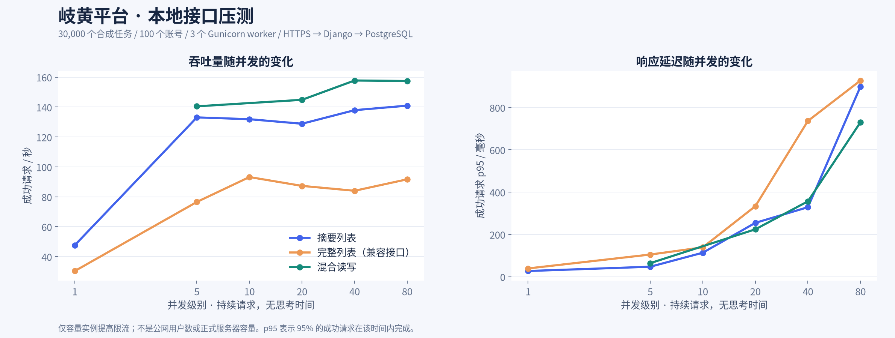
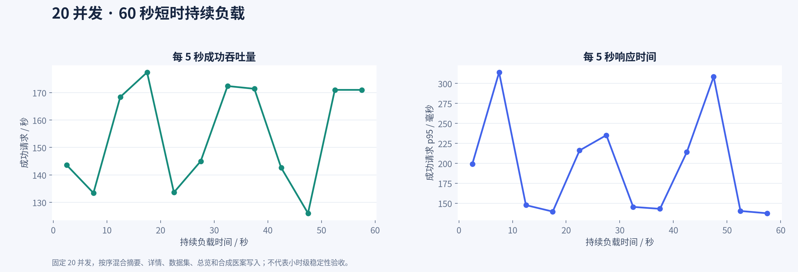
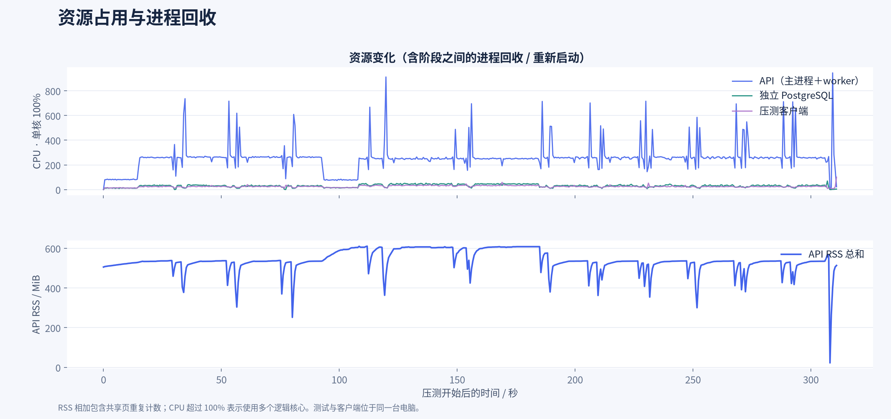

# 平台本地压测报告 · 2026-10-20

测试应用提交：`47eb89b`。开始时间：2026-10-20T15:44:34+0800。共 19 个阶段，实际请求窗口合计 322.2 秒，共 98,729 次请求（另有未计入的预热和权限检查）。容量阶段请求错误 0 次；正式限流阶段的 61,630 次 429 单独统计。

容量阶段实际 36,890 次请求。混合读写在 40/80 并发的吞吐分别为 157.7/157.4 次/秒，p95 分别为 356.5/730.4 ms；继续提高并发没有明显增加吞吐，却增加了排队。API 在这两个阶段分别约使用 2.7/2.6 个逻辑核心，数据库 CPU 约占单核的三成，瓶颈迹象主要在当前三个同步 worker。这个判断来自本机资源相关性，尚未通过增加 worker 的对照实验证明。

## 测试环境与方法

- 本机 Intel Core Ultra 5 125H，18 个逻辑 CPU，30.4 GiB 内存；压测客户端与服务端同机，其他桌面程序仍在运行。
- 独立 Nginx HTTPS → Gunicorn 3 个同步 worker → Django → PostgreSQL 17，另有独立 Redis。PostgreSQL shared_buffers 128 MiB，最多 64 个连接。Nginx 单 worker、512 个连接槽，客户端使用 HTTP/1.1 保持连接。
- 30,000 个合成任务、100 个有效会话，每个账号 300 个任务；结果含 8,192 字符的合成随机负载。另有 30,000 条任务来源关联。开始时数据集 1015 个、医案 1100 个，包含短预检保留的合成记录。
- 所有账号、文件和医案均为合成内容；未调用模型、外部生物数据库、邮件、R、S3 或后台分析队列。会话在准备阶段创建，本报告不测登录密码校验性能。
- 容量阶段只在独立压测实例把用户/入口限流提高到 600,000/min，正式配置未修改；最后重启测试 API/入口，按原 600/min 用户与入口配置单独测限流。
- 每个阶梯约 15 秒；并发 1、5、10、20、40、80。闭环客户端持续发请求、没有用户思考时间；服务变慢时到达率会随之下降，不能代表开放式固定到达率极限。
- p50/p95/p99 仅计算成功且校验通过的请求；错误、超时及 429 另计。每个阶段的平均速率包含最后一批请求的排空时间。先预热，阶段间没有停机冷却，Gunicorn 保留原 1,000～1,100 请求进程回收策略。

## 容量阶梯结果

| 场景 | 并发 | 请求数 | 成功/秒 | p50 ms | p95 ms | p99 ms | 错误 | 429 |
|---|---:|---:|---:|---:|---:|---:|---:|---:|
| summary-1 | 1 | 715 | 47.6 | 20.9 | 26.9 | 30.7 | 0 | 0 |
| summary-5 | 5 | 2,134 | 133.1 | 34.3 | 47.1 | 64.4 | 0 | 0 |
| summary-10 | 10 | 1,986 | 131.8 | 68.2 | 113.4 | 206.0 | 0 | 0 |
| summary-20 | 20 | 1,948 | 128.8 | 133.7 | 254.6 | 439.7 | 0 | 0 |
| summary-40 | 40 | 2,259 | 137.9 | 264.4 | 328.6 | 441.8 | 0 | 0 |
| summary-80 | 80 | 2,189 | 140.9 | 515.3 | 899.1 | 1,628.7 | 0 | 0 |
| legacy-1 | 1 | 456 | 30.4 | 32.0 | 39.1 | 83.6 | 0 | 0 |
| legacy-5 | 5 | 1,151 | 76.5 | 57.4 | 104.8 | 191.7 | 0 | 0 |
| legacy-10 | 10 | 1,408 | 93.2 | 103.1 | 138.8 | 226.0 | 0 | 0 |
| legacy-20 | 20 | 1,328 | 87.3 | 213.2 | 333.4 | 402.1 | 0 | 0 |
| legacy-40 | 40 | 1,293 | 84.0 | 437.4 | 736.5 | 1,006.7 | 0 | 0 |
| legacy-80 | 80 | 1,457 | 91.7 | 859.8 | 927.7 | 958.3 | 0 | 0 |
| mixed-5 | 5 | 2,111 | 140.5 | 30.2 | 64.0 | 95.2 | 0 | 0 |
| mixed-20 | 20 | 2,189 | 144.8 | 126.8 | 224.1 | 356.8 | 0 | 0 |
| mixed-40 | 40 | 2,509 | 157.7 | 251.1 | 356.5 | 444.7 | 0 | 0 |
| mixed-80 | 80 | 2,443 | 157.4 | 523.5 | 730.4 | 799.4 | 0 | 0 |

本轮最高成功吞吐阶段是 `mixed-40`，约 157.7 次/秒。这是该电脑、该数据与该接口组合的观测值，不能直接换算成注册用户数或公网服务器容量。并发增加后若吞吐趋平而 p95 上升，说明继续增加并发主要在增加排队。

## 持续负载、上传与限流

| 场景 | 并发 | 请求数 | 成功/秒 | p50 ms | p95 ms | p99 ms | 错误 | 429 |
|---|---:|---:|---:|---:|---:|---:|---:|---:|
| soak-20 | 20 | 9,299 | 154.7 | 121.9 | 203.1 | 295.1 | 0 | 0 |
| upload-5 | 5 | 15 | 21.2 | 206.2 | 369.7 | 369.7 | 0 | 0 |
| production-limits-20 | 20 | 61,839 | 13.9 | 30.9 | 141.7 | 189.6 | 0 | 61630 |

- 短时持续负载：20 并发，60.1 秒，成功 9,299 次，p95 203.1 ms。这只是 60 秒观察，不是小时级内存泄漏或故障恢复验收。
- 文件上传：5 并发，每个客户端上传 3 次，共 15 个约 0.99 MiB / 1,000 行 CSV，p95 369.7 ms。测本地私有文件落盘、解析、行记录和审计写入，未测 S3、100 MiB 大文件或恶意文件。
- 正式限流：61,839 次尝试中成功 209 次，61,630 次返回规范 429，其他错误 0。入口按同一个本机 IP 计算，600/min 加允许突发，所以短窗口的成功速率可能高于长期 10 次/秒；该阶段不是容量成绩。
- 研究者若共用同一单位出口 IP，会共同消耗入口 IP 额度。需要用正常访问节奏核实限流是否影响协作；本轮没有自动放宽正式保护。
- 写入一致性：本轮新增合成医案 858 条、上传 15 个，返回 ID 无重复、落库无丢失、审计增量匹配，上传文件哈希全部匹配。
- 权限检查：未登录摘要返回 401，跨用户详情返回 404；成功响应逐次检查所属用户及禁止缓存头。

## 资源观测

资源按 0.5 秒采样，阶段归属按实际请求时间窗计算；阶段之间的进程启动不算进请求阶段。API RSS 是主进程和 worker 的 RSS 相加，包含共享页重复计数，不是独占物理内存。CPU 单核 100%，多进程总计可以超过 100%。进程回收期间 RSS/延迟会波动；本轮客户端 CPU 也单独记录在 CSV，需警惕负载生成器本身成为瓶颈。

40 并发混合阶段：API 平均 CPU 273.2%，PostgreSQL 30.5%，客户端 24.4%；API RSS 峰值 536.1 MiB。负载生成器没有表现出接近单核满载的迹象。

并发不超过 40 时，容量阶段有 42 次超过 1 秒的响应，其中 42 次与 worker 启动/回收时间重叠或相距 3 秒内。这是时间相关性，不是因果证明；后续适合对照 worker 数量、初始化耗时和请求回收策略。当前没有修改这些生产设置。

## 结论与边界

1. 原完整列表仍会传输约 50 条完整结果，其吞吐和延迟应与摘要列表分开评估；当前前端使用摘要再按需读取详情。
2. 本轮未定义业务 SLO，不能把“无错误”直接称为生产验收通过。建议先根据正式服务器规格重复测试，再确定允许的 p95、峰值并发和保护额度。
3. 所有服务位于同机，使用本机自签 TLS；没有公网网络延迟、浏览器渲染、正式数据目录、冷缓存、多副本、持续任务计算或外部依赖故障。因此不是完整网页性能或整个平台极限容量报告。
4. 测试服务结束后自动停止；原预览库和研究资料未改动。独立合成数据库保存在本地忽略目录，原始逐请求记录位于 `python_app/var/loadtest/requests.jsonl`，会话和凭据没有进入本报告。

配套文件：`阶段数据.csv`、`资源采样.csv`、`metrics.json`、三张 PNG；均可在本地复核。
